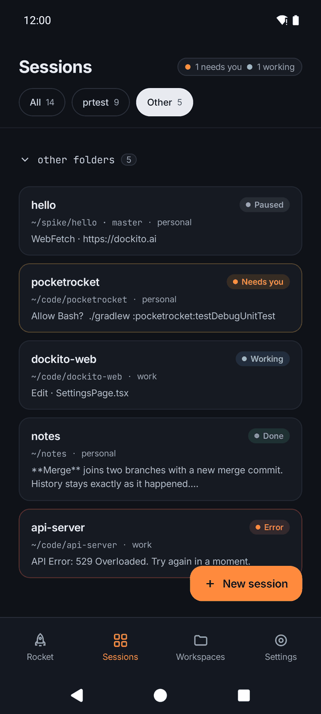
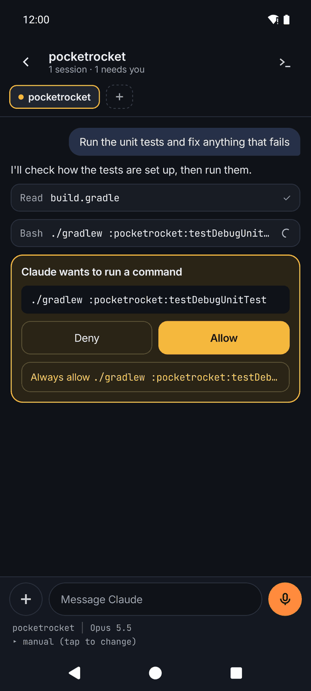
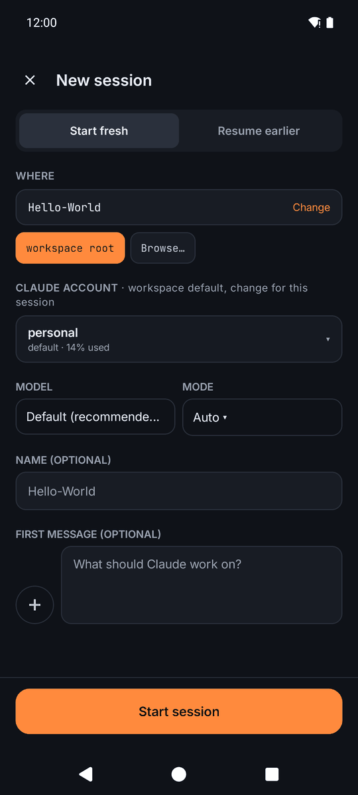
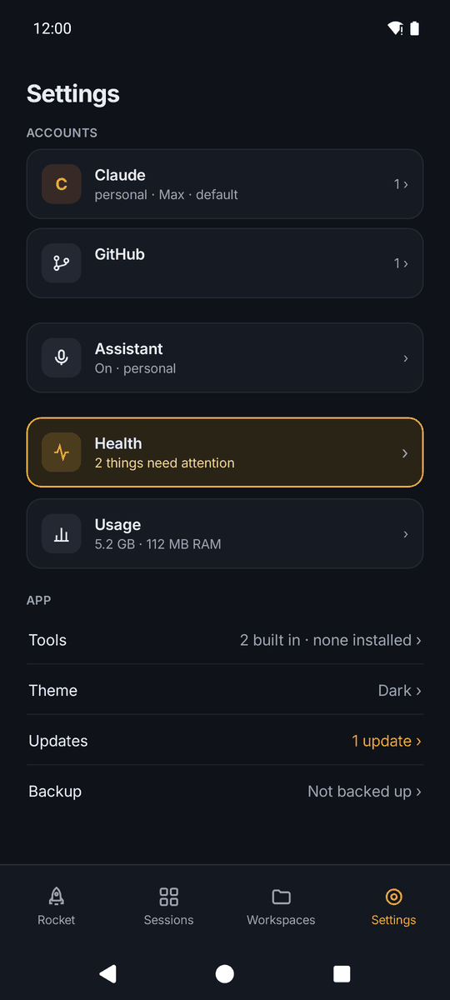
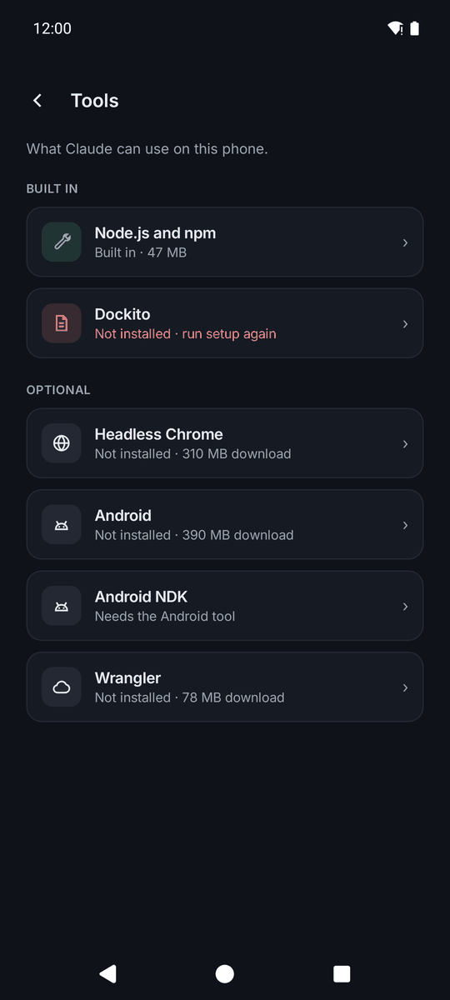
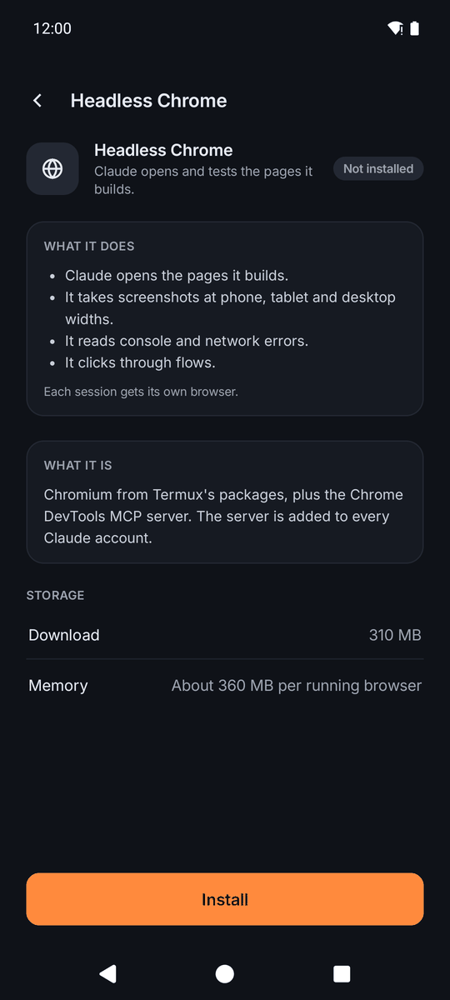

# PocketRocket

[](../../releases)
[](../../releases)
[](../../stargazers)
[](LICENSE.md)

<!-- The Views badge counts README loads, not unique visitors. -->

**The real Claude Code, running on your Android phone.** It's not a cloud session and it's not a remote shell into a laptop. Your repos, sessions, accounts and tools all live on the phone, and Claude works on them right there.

PocketRocket is a native Android app wrapped around Anthropic's own Claude Code CLI. You get a proper chat screen in place of a terminal. Several sessions run at once, each workspace has its own git and GitHub accounts, and a voice assistant can tell you what your sessions are doing.

PocketRocket is a fork of [Termux](https://github.com/termux/termux-app), licensed under the GNU GPL v3 (see `LICENSE.md`). It is not affiliated with Anthropic or the Termux project.

> **Early and experimental.** PocketRocket is a Dockito Labs project, under active development, and we use it every day. Things move fast and can break between releases, so expect rough edges.

## Screenshots

<table>
  <tr>
    <td align="center"><br><sub>Every session's state at a glance</sub></td>
    <td align="center"><br><sub>Chat with tool calls and permission cards</sub></td>
    <td align="center"><br><sub>Start a session: folder, account, model, mode</sub></td>
  </tr>
  <tr>
    <td align="center"><br><sub>Settings: accounts, health, tools, updates</sub></td>
    <td align="center"><br><sub>Tools: built in and add-ons</sub></td>
    <td align="center"><br><sub>A tool page: what it does, size, install</sub></td>
  </tr>
</table>

## Why we made it

We wanted a workstation in our pocket. A laptop is great at a desk, but we're not always at one, and work shouldn't have to wait until we are. With PocketRocket the phone is enough. You can start a task, let Claude work on it, check in, answer a question, look over the diff and push, whether you're on the sofa, travelling or out somewhere.

It's about comfort and convenience. It isn't meant to replace the laptop; it just means you don't have to depend on it for everything.

Phones are powerful enough now: the one we build on has 16 GB of RAM and 512 GB of storage. What was missing was a comfortable way to work on one. The Claude app runs Claude Code in Anthropic's cloud, not on your own folders and accounts. A raw Termux terminal is painful on a phone screen. So PocketRocket brings the parts we rely on at the laptop (several sessions, workspaces with repos, git, multiple accounts) onto the phone, made for the screen in your hand.

## What it does

### Sessions and chat
- **A chat UI, not a terminal.** A native chat drives the real CLI, with streaming replies, tool calls, permission cards (Allow, Deny, Always allow), subagents you can open full screen, background shells, a `/` command picker, attachments (files, camera, screenshots, clipboard) and dictation.
- **Many sessions at once.** Home shows each session's state: working, needs you, done or error. Notifications let you Allow or Deny without opening the app. Sessions resume after Android kills the app.
- **The controls you know.** Switch between Manual, Accept edits, Plan and Auto modes, change model and effort, Compact, Stop, Rewind, Edit and Retry. Messages you send while Claude is working wait in a queue.

### Workspaces and git
- **Workspaces** are your own folders under `~/projects`, each holding one or more repos. Clone from a URL or pick from your GitHub repos. A built-in file manager lets you browse them.
- **Git without leaving the app.** Changes, staging, commits, push and pull, diffs, branches, a commit graph, pull requests and worktrees.

### Accounts
- **Several Claude and GitHub accounts.** Each workspace picks its own Claude account and its own GitHub account. The GitHub account sets the commit identity, the SSH key and the `gh` login, so personal and work never mix. Logins use the official sign-in pages.
- **Configure Claude Code per account:** connectors and MCP servers, plugins, skills, `CLAUDE.md`, settings, output style.

### Rocket, the voice assistant
- Ask out loud what your sessions are doing, approve or deny a request, or start new work. Rocket answers from the app's real state and hands bigger jobs to Claude Code. Sensitive actions need your fingerprint every time. "Hey Rocket" is off unless you turn it on.

### Tools
- **Included:** Claude Code, git, gh, Node.js and npm.
- **Add-ons**, installed from Settings → Tools when you want them: Headless Chrome (so Claude can open and test the pages it builds), Android SDK builds, Android NDK, Flutter & Dart (with FVM), Rust, and Cloudflare Wrangler with local dev. Nothing is bundled. Each add-on is downloaded when you install it, and you can remove it later.
- **A raw terminal** whenever you want one. It's still Termux underneath, so `pkg install` works.

### Keeping it alive
- **Health screen.** Android loves to kill background apps. Health checks every battery, autostart, permission and setup setting that can stop a session in your pocket, and each one has a Fix button. It also shows when and why Android last stopped the app.
- **Usage, Updates, Backup.** See storage, RAM and battery use per session. Update Claude Code and the app from Settings, and roll Claude Code back if a release misbehaves. Back up your setup to one file and restore it after a reinstall.

## How it works

- PocketRocket is a fork of [Termux](https://github.com/termux/termux-app). The terminal, packages and foreground service come from Termux, and the app around them is new, written in Jetpack Compose.
- On first run it downloads Claude Code's `linux-arm64` build straight from Anthropic, checks it against Anthropic's published SHA-256 manifest, and runs it through a glibc launcher. The Claude Code binary is never shipped in the APK or the repo.
- Claude runs on the phone itself. The only traffic is what Claude Code, git and your tools send anyway. The app has no analytics or tracking of its own.

## Requirements

- An **arm64 Android phone**. We build and test on Android 16 (Poco F7); older versions may work but aren't tested.
- A **Claude account** with Claude Code access, such as a Pro or Max plan.
- A few GB of free space, plus more for any add-on tools.
- Android only: iOS doesn't let an app run programs like this.

## Install

1. Open [Releases](../../releases) and download `pocketrocket-vX.Y.Z-arm64.apk` from the newest **PocketRocket** release.
2. Open the APK and allow your browser or file manager to install apps when Android asks.
3. Open PocketRocket. First run takes a few minutes while it installs Claude Code and the base tools, and shows progress as it goes.
4. Sign in to Claude (one tap opens Anthropic's sign-in page), then optionally connect GitHub.
5. Go through Settings → Health and tap Fix on anything red, so Android leaves your sessions alone.

After that, the app updates itself from Settings → Updates, so there's no need to come back here.

The package id is `app.pocket`, so it installs next to a regular Termux. It won't be on Google Play: Play doesn't allow apps that download and run native programs, and that's exactly what this app does.

## Build

You need the Android SDK with NDK, and JDK 17 or newer.

```
./gradlew assembleDebug
```

- Docs: `docs/BRD.md` (what and why), `docs/PROGRESS.md` (where it stands), `docs/decisions.md` (every decision), `AGENTS.md` (rules for coding agents).
- Termux's original README is kept at `docs/upstream-termux-README.md`; third-party notices are in `THIRD_PARTY.md`.

## Feedback

Bug reports and ideas are welcome in [Issues](../../issues). It's an experimental Labs project, so we can't promise a fix or a reply to everything. For security problems, see `SECURITY.md`.

## Credits and licence

- **Termux.** A fork of [Termux](https://github.com/termux/termux-app), licensed GPLv3. The same licence applies here; see `LICENSE.md`.
- **The glibc launcher.** The way Claude Code's glibc binary runs on Termux comes from [claude-code-android](https://github.com/ferrumclaudepilgrim/claude-code-android) (MIT); see `setup/NOTICE`.
- **Claude Code** is Anthropic's software, downloaded from Anthropic at first run under their terms.

PocketRocket is made by Dockito Labs. It is not affiliated with Anthropic, Google, Cloudflare or the Termux project.
